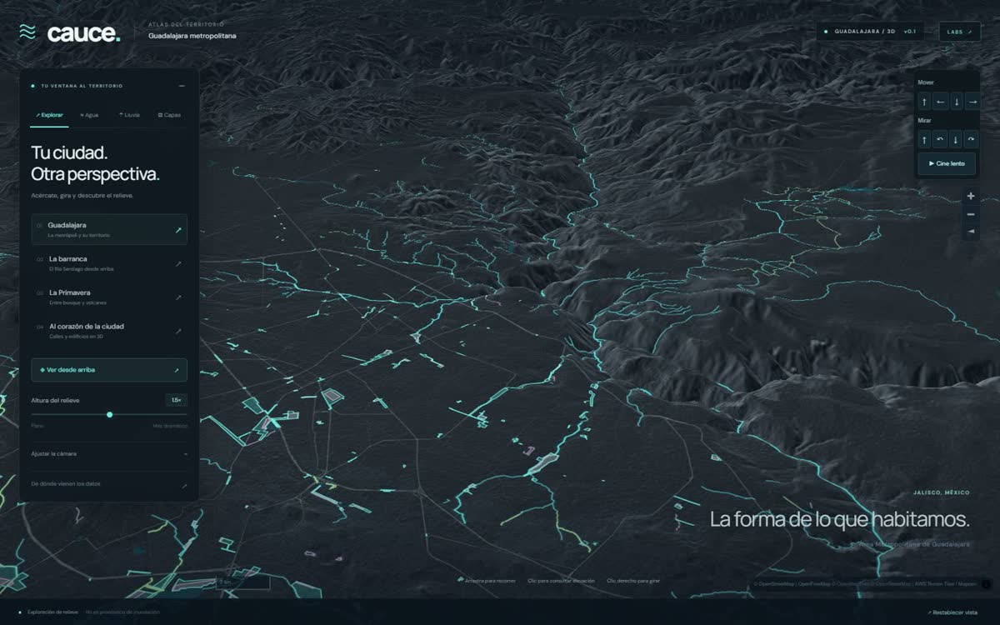
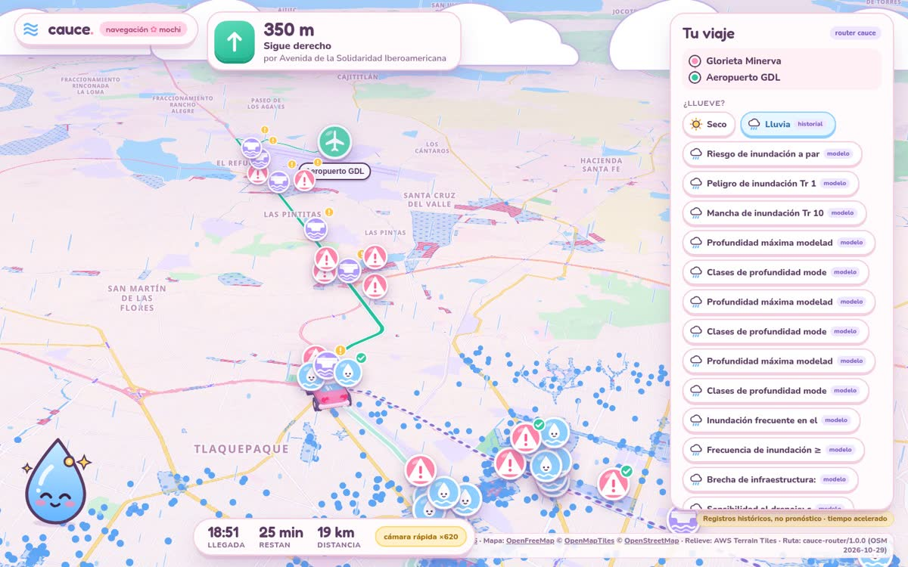
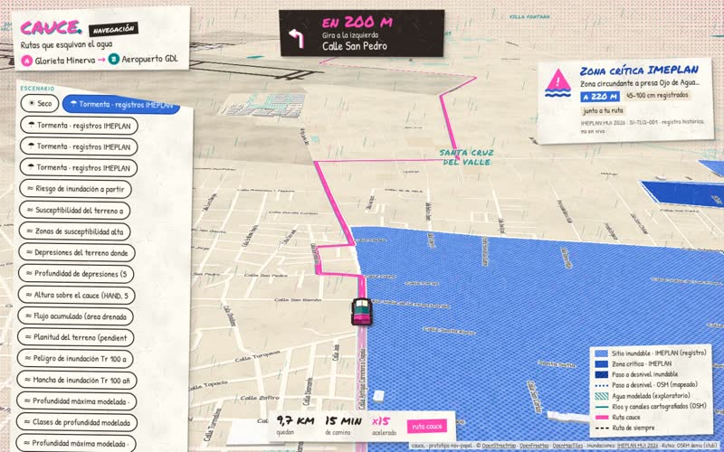
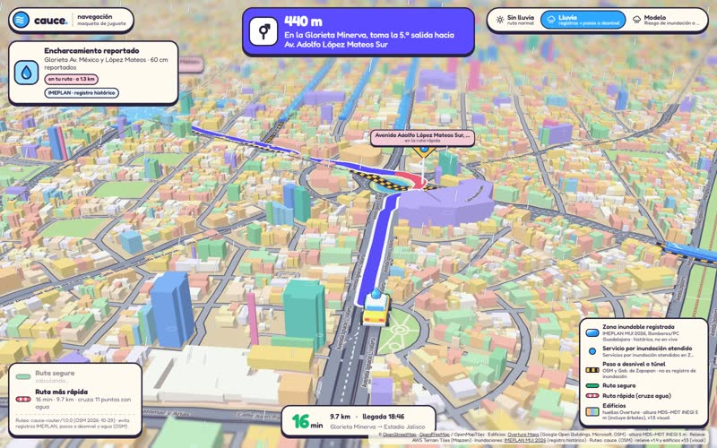
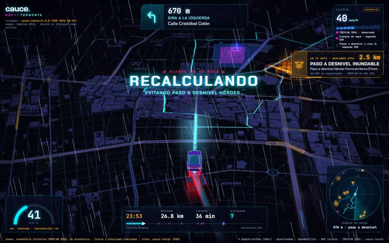
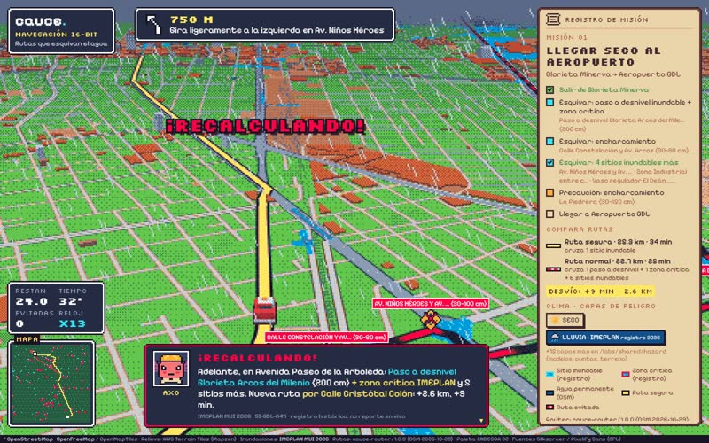
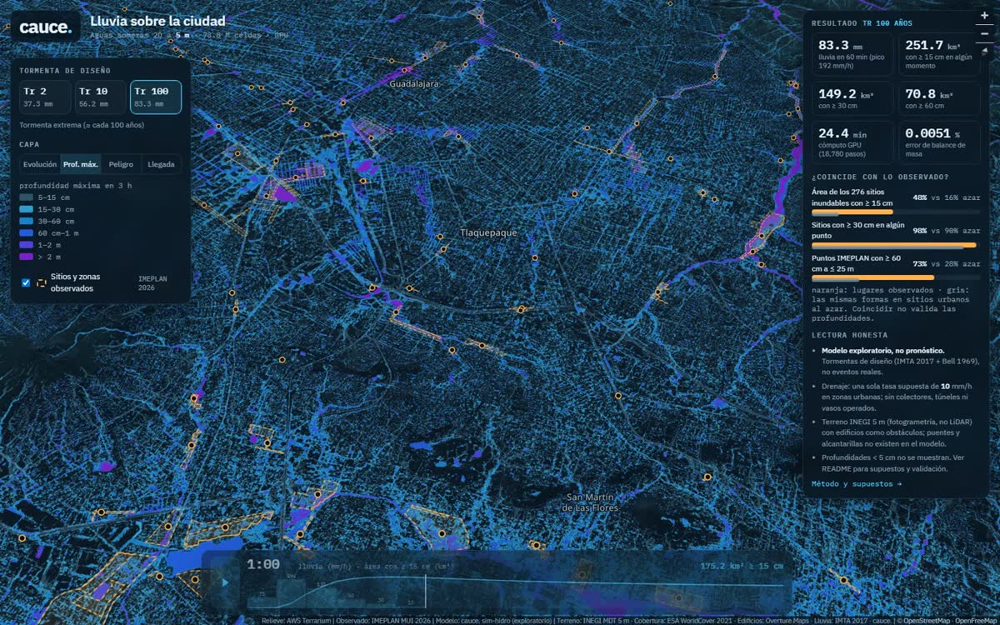
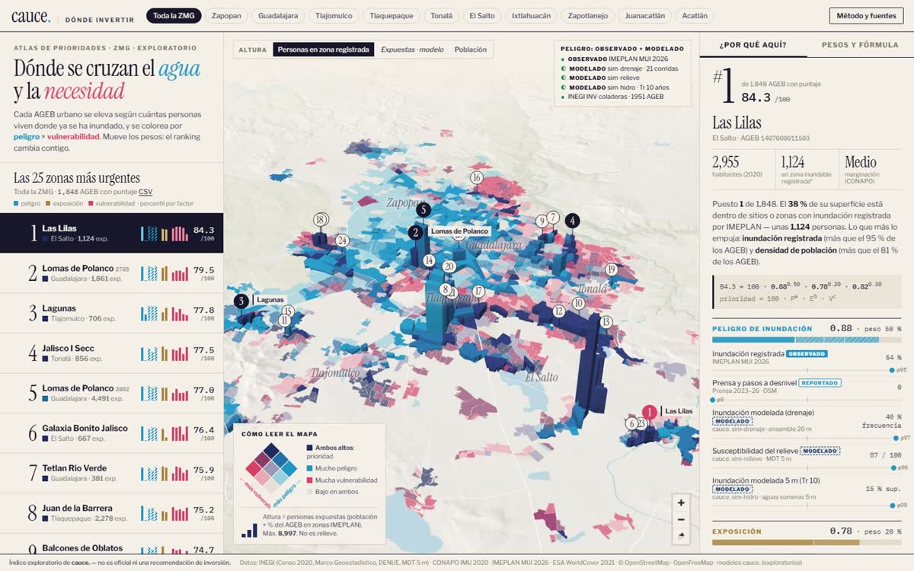
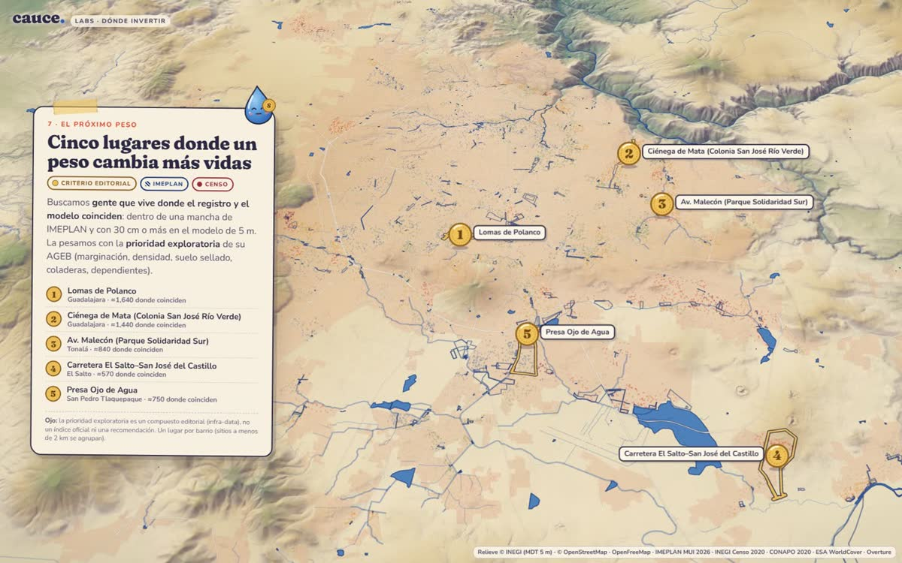
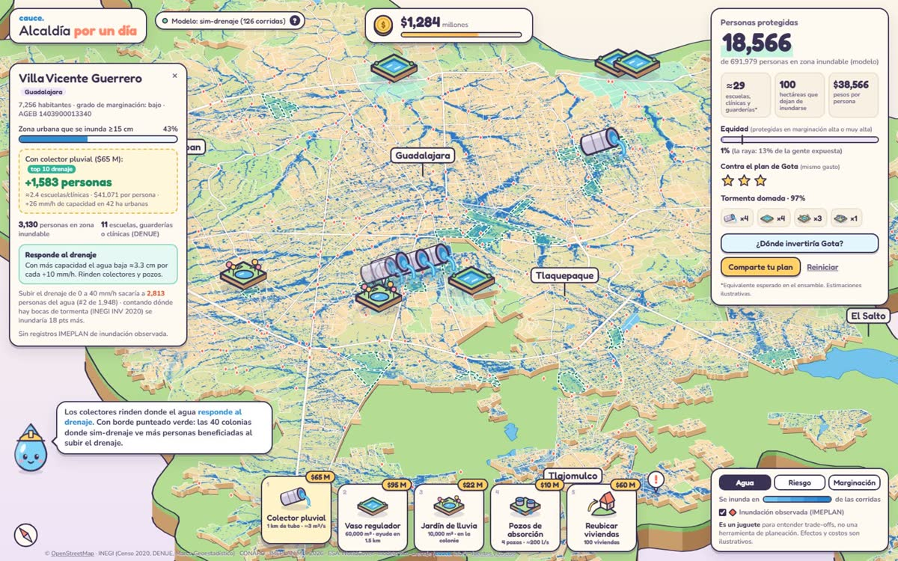

# cauce.

**Guadalajara se inunda cada temporada de lluvias y ningún navegador te avisa.** cauce. es un atlas 3D de la Zona Metropolitana de Guadalajara que junta terreno INEGI de 5 m, los 310 sitios inundables registrados por IMEPLAN y simulaciones de lluvia para mostrar tres cosas: dónde se junta el agua, cómo llegar de A a B sin cruzarla y dónde hace falta infraestructura.

Proyecto para el hackathon de Codex (octubre de 2026).

| | |
|---|---|
| **Video demo (1:15)** | https://codex-hackaton.vsfelix.com/video-demo/ |
| **Atlas** | https://codex-hackaton.vsfelix.com |
| **Navegar sin mojarse** | https://codex-hackaton.vsfelix.com/labs/nav-mochi/ |
| **Labs: navegación, simulaciones, dónde invertir** | https://codex-hackaton.vsfelix.com/labs/ |

Los mismos sitios responden también en `guadalajara.vsfelix.com`.

[](https://codex-hackaton.vsfelix.com/video-demo/)

El video demo sigue una tarde de tormenta de la Glorieta Minerva al aeropuerto con la navegación Mochi, muestra de dónde sale su mapa de riesgo y termina en dónde invertir. En la misma página está el recorrido completo de los labs (2:10), con los cinco estilos de navegación que probamos.

*In English: cauce. is a 3D flood atlas of metropolitan Guadalajara, Mexico. It combines INEGI's 5 m terrain, the 310 flood sites recorded by the metro planning agency (IMEPLAN) and rain simulations run on a home GPU, then uses them for navigation that routes around flood-prone streets and for maps of where drainage investment would help most. [English summary below](#in-english).*

---

## Qué hay

### 1. El atlas (`/`)

Mapa 3D del relieve con los sitios de inundación de IMEPLAN, ríos y arroyos de OpenStreetMap, edificios en 3D, la cobertura de los modelos de terreno de INEGI y una simulación de lluvia que corre en el navegador sobre la elevación real, con balance de agua a la vista.



### 2. Navegar sin mojarse

Navegación de A a B con la cámara inclinada siguiendo a un coche 3D. La ruta evita las zonas críticas de IMEPLAN, los pasos a desnivel que se inundan y el agua simulada; avisa «¡Recalculando!» antes de cada punto con registro y compara la ruta segura contra la normal (por ejemplo, Minerva → Aeropuerto: +8 min para esquivar 6 sitios inundables y un paso a desnivel).

[](https://codex-hackaton.vsfelix.com/labs/nav-mochi/)

El estilo principal es **Mochi**: pastel, con Gotita de copiloto, un mapa de calor del riesgo modelado y los sitios de IMEPLAN marcados aparte. La página abre ya manejando (Minerva → Aeropuerto) y con «Elegir mi destino» puedes trazar tu propia ruta. Antes de elegirlo probamos otros cuatro estilos con el mismo ruteador y los mismos datos:

| Papel · risografía | Juguete · diorama 3D | Neón · noche de tormenta | Pixel · misión de 16 bits |
|---|---|---|---|
| [](https://codex-hackaton.vsfelix.com/labs/nav-papel/?demo=1) | [](https://codex-hackaton.vsfelix.com/labs/nav-juguete/?demo=1) | [](https://codex-hackaton.vsfelix.com/labs/nav-neon/?demo=1) | [](https://codex-hackaton.vsfelix.com/labs/nav-pixel/?demo=1) |

Con `?demo=1` cada uno maneja solo.

### 3. Tres simulaciones

| Prototipo | Qué hace |
|---|---|
| [Lluvia sobre la ciudad](https://codex-hackaton.vsfelix.com/labs/sim-hidro/) | Aguas someras sobre terreno de 5 m con edificios (73.8 millones de celdas) en una GPU de casa (RX 580, WebGPU). Tormentas de 2, 10 y 100 años de periodo de retorno. |
| [¿Lo plano se inunda?](https://codex-hackaton.vsfelix.com/labs/sim-relieve/) | Índices del terreno (pendiente, altura sobre el cauce, acumulación de flujo) contra los registros de IMEPLAN para probar la hipótesis «las zonas planas son las que se inundan». |
| [Tormentas × drenaje](https://codex-hackaton.vsfelix.com/labs/sim-drenaje/) | 132 corridas que cruzan intensidad de lluvia con capacidad de drenaje para separar dónde ayuda más drenaje y dónde hace falta almacenamiento. |



### 4. ¿Dónde invertir? 3 prototipos

| Atlas de prioridad | Historia ilustrada | Alcaldía por un día |
|---|---|---|
| [](https://codex-hackaton.vsfelix.com/labs/invertir-1/) | [](https://codex-hackaton.vsfelix.com/labs/invertir-2/) | [](https://codex-hackaton.vsfelix.com/labs/invertir-3/) |
| Cada AGEB se eleva según la gente expuesta; pesos ajustables y las 25 zonas más urgentes. | De la sierra a la ciudad: dónde se junta el agua, quién vive ahí y dónde rinde el siguiente peso. | $2,000 millones para colectores, vasos reguladores y jardines de lluvia: personas protegidas por peso y equidad. |

## Lo que encontramos

Todo es exploratorio: los modelos no están calibrados y no son pronósticos.

- **Lo plano se inunda porque es bajo.** La altura sobre el cauce más cercano (HAND) predice los sitios de IMEPLAN con AUC 0.79. A igual altura, lo plano no agrega nada; el modelo combinado llega a 0.807 (validación cruzada por bloques espaciales).
- **66 % de las manzanas de la ZMG no tiene boca de tormenta** (INEGI, Inventario Nacional de Viviendas 2020). No existe un inventario público de la red pluvial del SIAPA.
- **Tormenta de 100 años (83 mm en 1 h):** 252 km² con 15 cm de agua o más. Los sitios de IMEPLAN salen más mojados que puntos al azar (48 % contra 16 % del área con 15 cm o más).
- **El drenaje rinde con las lluvias frecuentes.** 40 mm/h de capacidad distribuida quita 54 % del área inundada con la tormenta de 2 años y solo 25 % con la de 100. Unos 72 km² siguen inundados con cualquier drenaje: ahí hace falta almacenamiento o regrading.
- **Equidad.** El plan que protege más personas por peso manda 0.3 % de su beneficio a zonas de alta marginación, donde vive 12.6 % de la población expuesta.

## Datos

| Fuente | Uso |
|---|---|
| INEGI, Modelos Digitales de Elevación y de Superficie de 5 m | Terreno de las simulaciones; altura de edificios (superficie − terreno) |
| IMEPLAN, Mapa Único de Inundaciones 2026 | 310 sitios inundables y 188 zonas críticas (registros históricos, no avisos en vivo) |
| INEGI, Censo 2020 e Inventario Nacional de Viviendas 2020; CONAPO | Población expuesta, marginación, bocas de tormenta por manzana |
| OpenStreetMap / OpenFreeMap | Calles, ríos y arroyos, mapa base vectorial, ruteo |
| Overture Maps | 1.8 millones de huellas de edificios |
| AWS Terrain Tiles (Terrarium) | Relieve global del atlas |
| IMTA 2017; Campos-Aranda 2010 | Tormentas de diseño (curvas IDF regionales) |
| ESA WorldCover; Gobiernos de Guadalajara y Zapopan | Cobertura de suelo; reportes ciudadanos usados para validar |

## El repositorio

```
dist/            el atlas que se publica en / (HTML, CSS y JS sin compilar)
  video-demo/    la página del video demo
  data/          capas pequeñas: sitios IMEPLAN, red de agua, cobertura INEGI
labs/            código y documentación de los prototipos de /labs/
docs/img/        imágenes de este README
tests/           pruebas de la simulación de lluvia del atlas
tools/           snapshot-labs.mjs: copia el código de los labs a labs/
serve.mjs        servidor local
deploy-vps.mjs   publicación atómica en el VPS
```

Cada prototipo en `labs/` tiene su propio README con fuentes, decisiones y limitaciones. Los datos pesados de los labs (teselas de terreno, resultados de simulación, unos 1.6 GB) no están en git; se sirven en vivo desde `/labs/shared/` y `labs/DATA-MANIFEST.json` los enumera.

### Correr local

Requiere Node.js 18 o más reciente; no hay dependencias.

```sh
node serve.mjs   # http://127.0.0.1:4187
```

### Pruebas

```sh
node --test tests/rain.test.mjs
```

## Cómo se hizo

- **Mapa:** MapLibre GL, teselas vectoriales de OpenFreeMap, relieve Terrarium.
- **Terreno de 5 m:** 152 hojas INEGI armonizadas y mosaicadas en EPSG:6368 (14,760 × 16,760 celdas). Para simular se suman los edificios: terreno + altura de edificio (de 3 a 60 m).
- **Simulación:** aguas someras en WebGPU, corrida en una PC de casa (Ryzen 5 2600, RX 580) que también renderizó cada cuadro del video. Unos 24 minutos de GPU por tormenta.
- **Ruteo:** un ruteador propio en el navegador que penaliza zonas críticas, pasos a desnivel y agua modelada; bloquea por defecto los puntos críticos.
- **Video:** cada cuadro es la interfaz real de un prototipo, capturada con Chromium sin pantalla mediante el gancho `window.__cauceDemo.seek(t)` de cada página. Nada es una maqueta.

## Limitaciones

- Los modelos son exploratorios y no están calibrados con eventos medidos; no sirven para decidir sobre una colonia o vivienda.
- Los registros de IMEPLAN son históricos. La navegación los usa como «aquí se ha inundado», no como aviso en tiempo real.
- Los modelos INEGI de 5 m son fotogrametría satelital, no LiDAR.
- No hay red pluvial pública; el drenaje se modela como capacidad distribuida.
- Las dos simulaciones dinámicas usan fuentes de tormenta distintas (IMTA 2017 y Campos-Aranda 2010), así que sus profundidades no se comparan directamente.

## In English

cauce. ("riverbed") is a 3D flood atlas of metropolitan Guadalajara, Mexico, built for the Codex hackathon (October 2026). Guadalajara floods every rainy season, and no navigation app warns you about it.

- **Atlas** (`/`): 3D terrain with IMEPLAN's 310 recorded flood sites, OSM rivers and streams, 3D buildings and an in-browser rain model with a visible water balance.
- **Navigation** (`/labs/nav-mochi/`): a pastel navigation mode that follows a 3D car and routes around recorded flood sites and flood-prone underpasses, plus four alternative styles explored with the same router (risograph, toy diorama, neon storm, 16-bit pixel).
- **Simulations** (`/labs/sim-*`): a 5 m shallow-water rain model (73.8 M cells, WebGPU on a home RX 580) for 2-, 10- and 100-year storms; a terrain-index test of the hypothesis "flat areas flood"; and a 132-run storm × drainage-capacity ensemble.
- **Where to invest** (`/labs/invertir-*`): a priority atlas with adjustable weights, an illustrated story and a budget game.

Findings (exploratory, not forecasts): flat areas flood only because they are low (height above nearest drainage, AUC 0.79); 66 % of city blocks have no storm inlet; more drainage removes 54 % of flooded area in a 2-year storm but 25 % in a 100-year storm; and the most cost-efficient plan sends 0.3 % of its benefit to high-marginalization areas that hold 12.6 % of the exposed population.

Video demo (1:15): https://codex-hackaton.vsfelix.com/video-demo/ (a stormy drive from Glorieta Minerva to the airport with the Mochi navigation, where its risk map comes from, and where to invest; the 2:10 tour of every prototype is on the same page).

Run locally with `node serve.mjs` (Node.js 18+, no dependencies); test with `node --test tests/rain.test.mjs`.
