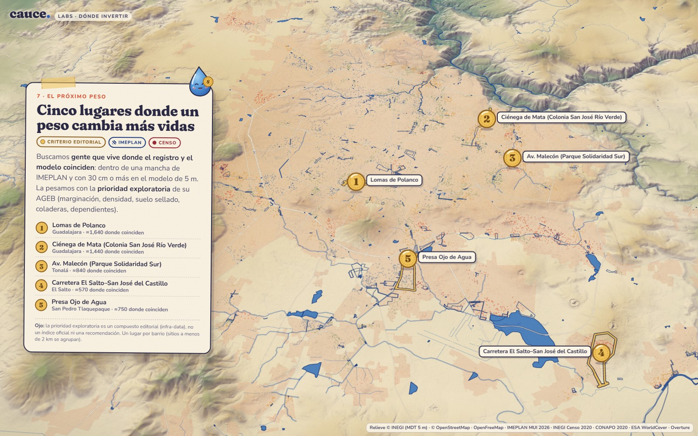

# cauce. · invertir-2 — «¿Dónde cae el próximo peso para el drenaje?»

Live: https://guadalajara.vsfelix.com/labs/invertir-2/ · film mode: `?demo=1` (30 s loop) · frozen: `?demo=1&still=1`
Agent: `invertir-2`. Status: `/labs/shared/status/invertir-2.json`.

## Concept

This is an illustrated scrollytelling story for the "dónde invertir" use. It follows one storm from the mountains to
the city and ends at the few places where flood investment would help the most people. Fourteen steps, in Spanish:

| # | Step | What the map does | Data |
|---|---|---|---|
| 0 | Portada — *¿Dónde cae el próximo peso…?* | A high oblique view of the whole valley, with drifting clouds and light rain | INEGI 5 m relief, OSM water |
| 1 | Todo empieza en la sierra | The camera flies to La Primavera at a 72° pitch. A storm darkens the sky and the rain gets heavy | storm depth of the model shown in step 3 (sim-hidro: 56 mm/1 h, Tr 10) |
| 2 | Baja por arroyos… y por calles | Particles flow down the OSM streams toward the Huentitán canyon. Light lines show D8 flow accumulation with buildings as walls | OSM waterways; sim-relieve `acumulacion` |
| 3 | Se junta en lo plano y lo bajo | Modelled water ≥ 30 cm fills the low places minute by minute (scroll scrubs the storm clock), drawn over the hatched IMEPLAN zones | sim-hidro T10 frames; IMEPLAN; sim-hidro validation (85 % vs 59 %) |
| 4 | ¿Se inundan las zonas planas? | HAND (height above nearest drainage) in blue, with IMEPLAN outlines | sim-relieve stats `hypothesis` (answer, AUCs) + `hand` tiles |
| 5 | Debajo del agua hay barrios | People dot map (1 dot = 150 people) coloured by marginalization. Dots in AGEBs that touch a recorded zone are bright | Censo 2020, CONAPO IMU 2020, DENUE |
| 6 | No todo se arregla con tubos | sim-drenaje gap map: aqua = responds to drainage, orange = persists. Includes a bar chart of exposed people by drainage capacity | sim-drenaje tiles + `ageb-drainage.json` |
| 7 | Cinco lugares… | Five peso coins drop onto the ranked places | see Ranking |
| 8–12 | #1 … #5 | A close-up of each place with a fact sheet: observed, 5 m model, terrain, pipes or storage | all of the above |
| 13 | Una exploración, no un pronóstico | How to read the story, buttons that re-rank the places, and the full list of sources | — |

**Art direction: gouache storybook.** The base is a warm paper sheet with a multiply grain. The INEGI 5 m DTM is drawn
in 3D at exaggeration 1, as a hand-picked hypsometric `color-relief` (teal canyon → cream valley → ochre foothills →
sage/forest sierra → violet peaks) under an `igor` hillshade with plum shadows. The city is a terracotta wash made from
the AGEB footprint. Water is ultramarine. Observed records are **ink hatching** and modelled water is a **flat blue
wash**. OSM streams are ink lines, with culverts dashed. Hand-lettered labels in Caveat Brush give elevations sampled
from the INEGI DTM. The cards are taped paper. The type is Fraunces (display) and Nunito (text). The narrator is
**Gota**, a hand-built SVG raindrop who changes pose in every chapter (falls, slides, pools, investigates, thinks,
holds the peso). The prototype has no template UI: the map is not interactive, and scrolling drives everything.

## Ranking (editorial — stated on screen)

1. Each IMEPLAN site (polygons grouped by base id, e.g. `SI-GDL-048`) is a *place*. The people inside it come from
   the site's sampled overlap with every urban AGEB (`data/sitios.json`). Each AGEB's population is spread evenly
   over its area (gross density).
2. Once sim-hidro exists, the default ranking (**«Registro y modelo coinciden»**) is
   `people in the zone × share of the zone with modelled max depth ≥ 30 cm (sim-hidro T10) × prio_exploratoria/100`,
   where the priority is population-weighted over the overlapping AGEBs. In plain words, it counts people who live
   where the record and the model agree, weighted by the infra-data editorial priority. Without sim-hidro it falls
   back to `people × priority` (observed only).
3. There is one coin per neighbourhood: a site within 2 km of a higher-ranked one is skipped.
4. The last card can re-rank by *gente × prioridad (solo registro)*, *solo gente* or *marginación*. This shows how
   much the result depends on the choice. With the observed-only ranking, the two largest IMEPLAN zones (El Salto,
   Presa Ojo de Agua) come first, but both models barely flood them (3–4 % ≥ 30 cm). Their place cards say so.

`prio_exploratoria` is called an editorial composite, not an official index, wherever it appears.

## Data used (loaded at runtime; every input degrades gracefully)

| Input | Use |
|---|---|
| `/labs/shared/terrain/index.json` → `dtm-inegi-5m` | 3D terrain and hillshade/colour relief. A custom `cdem://` protocol serves INEGI tiles inside the grid envelope and AWS Terrarium outside it, as the terrain index prescribes. The surface continues to the horizon instead of dropping to 0 m at the AOI edge |
| `/labs/shared/infra/ageb-profile.geojson` | city footprint, dots, all census/marginalization/facility numbers, priority |
| `/labs/shared/hazard/observed-imeplan-2026.geojson` | hatched zones, counts, place references (`Referencia`, `Rango de alturas`, `Motivo`) |
| `/labs/shared/infra/osm-waterways.geojson`, `/labs/shared/hazard/water-bodies.geojson` | ink streams, flow particles, lakes |
| `/labs/shared/infra/buildings/` (Overture MVT) | footprints with offset shadow in the place close-ups (z ≥ 14) |
| OpenFreeMap planet tiles | roads only (no labels) |
| `hazard/index.json` → `sim-hidro-t10-profundidad` (+ `stats.json`) | z14 max-depth tiles sampled inside each top site (`share ≥ 30 / 60 cm`); validation numbers; storm depth |
| `data/frames-hidro/` (derived, see below) | animated water in step 3 |
| sim-relieve: `stats.json` (`hypothesis`), `tiles/{acumulacion,hand}`, `ageb-terrain.json` | steps 2 and 4; terrain susceptibility per place (overlap-weighted `susc_mean`) |
| sim-drenaje: `stats.json`, `tiles/gap`, `web/indicators.png`, `ageb-drainage.json` | step 6 map, km², exposure-by-capacity chart. Each place gets "pipes or storage" from the gap class sampled inside its zone |

Model products are read from `hazard/index.json` when registered. Products already published but not yet registered
(sim-drenaje is still running its ensemble) are used from their documented paths and carry a **«preliminar»** chip
with the run count. Without any model, steps 3 and 6 show an observed-only version and say so.

### Derived data products (this agent)

| File | What | Rebuild (VPS, from `/srv/contorno/data/guadalajara-flood-lab/work/invertir-2/`) |
|---|---|---|
| `data/sitios.json` | 312 IMEPLAN sites: reference, categories, centroid, bbox, sampled area and overlap m² with each AGEB (12 m grid), nearest OSM place name | `node build/prep.mjs` |
| `data/landmarks.json` | 14 landmarks (OSM names), with elevation sampled from the INEGI DTM z13 tiles (peaks = highest pixel within ~300 m, canyon = lowest within ~600 m) | `node build/prep.mjs` |
| `data/frames-hidro/` | sim-hidro T10 frames 10–90 min, recoloured to the story palette, **≥ 30 cm only**, isolated pixels removed. Accepts both palettes sim-hidro has published (README legend and `DEPTH_STOPS`) | `node build/frames-hidro.mjs` (re-run when sim-hidro republishes T10) |
| `data/frames-drenaje/` | fallback animation from sim-drenaje Tr 10 / 20 mm/h depth classes, same treatment | `node build/frames-drenaje.mjs` |

`screenshot-cover.jpg` is the cover frame (t = 1.2 s). Copies of the scripts are in `tools/`; they need `pngjs` (installed in the work dir). OSM place and peak names were
fetched once from Overpass into `work/invertir-2/raw/`.

## Demo mode

`?demo=1` hides the rail, the scroll cue and the buttons. It plays a 30 s schedule:
cover → rain → runoff → water filling (the clock scrubs minutes 12–80) → flat or low → who lives there → pipes or
storage → coins drop → place #1 → closing card. The cards cross-fade in place instead of scrolling.
`window.__cauceDemo = { duration_s: 30, ready, seek(t) }`. `seek(t)` renders the frame at `t` seconds from a pure
state function (camera, layer opacities, sky, rain, particles, clouds, coins and cards all depend only on `t`), waits
until the map and its tiles have loaded, redraws the overlay, and resolves after two animation frames. `?demo=1&still=1`
turns off autoplay. Every random element uses a fixed seed. Capture helper for W10: `tools/w10-shot2.mjs`
(`node shot2.mjs <url> <prefix> <w> <h> <t1,t2,…> [scale]`).

Other URL options: `?step=k` opens the scroll version at step k. `?camfor=k&cam=lon,lat,zoom,pitch,bearing` overrides
one camera (for tuning).

## Decisions

- **Scroll is the only control.** A single state function maps scroll (or demo time) to `(a, b, e)`: from step,
  to step, eased fraction. The transition is held still for the first and last ~17 % of each gap so a card can be read
  while the camera rests. Long flights zoom out in the middle (the arc scales with distance).
- **Water ≥ 30 cm only** in the animation. sim-hidro's own frames start at 10 cm and wash the whole city in light
  blue, which hides the "water collects in low places" message. The legend shows this threshold.
- **The storm in step 1 is the storm of the model in step 3** (sim-hidro: IMTA 2017 design hyetograph scaled to
  10 years, 56 mm), so the numbers in the story agree. sim-drenaje uses a different IDF (63 mm). That number is only
  used when sim-drenaje's frames are the fallback.
- **Observed, modelled and mapped stay visibly distinct:** observed is ink hatching with dark outlines, modelled is a
  flat wash or aqua/orange cells, and mapped (OSM) is line work. Every card has chips that name the kind of data.
- The flow particles are illustrative: they move along OSM waterways in their drawn direction at a time-lapse speed.
  They are not a model. Rain streaks are decoration.
- Performance: `map.project` with terrain costs ~0.25 ms per call, so the overlay projects with the transform's 3D
  pixel matrix and cached per-vertex elevations (`frameProjector`). The result is identical to `map.project`
  (checked on W10).

## Limitations

- Everything is exploratory: design storms, an assumed drainage rate, no public storm-sewer network, and a
  photogrammetric DEM without culverts. The IMEPLAN inventory reflects where people reported floods.
- "People inside a zone" spreads each AGEB's population evenly. Small, narrow zones along streets get only a few
  people. Large zones get many.
- The sim-drenaje ensemble was still running when this was written (52 of 132 runs). Its gap tiles, `stats.json` and
  `ageb-drainage.json` change as runs are added. The app reads them live, and the step 6 chip shows the run count.
- The place names are the nearest OSM `place=*` node within 500 m when one exists, otherwise a shortened IMEPLAN
  reference. They are for orientation only.
- On a busy W10 GPU (simulations running), the live scroll ran at about 12–17 fps during camera flights. Filming uses
  `seek(t)`, which does not depend on frame rate.
