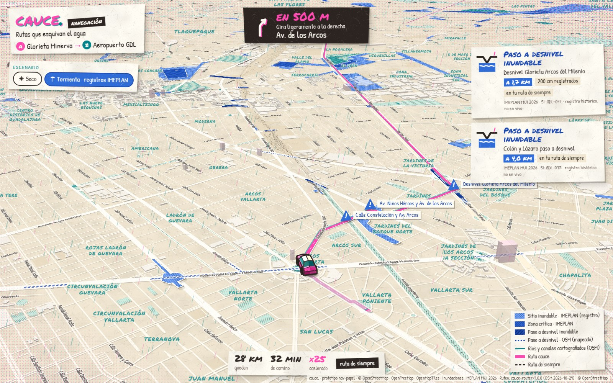

# cauce. · nav-papel: navigation that avoids recorded flooding (paper cut-out + riso)

Live: https://guadalajara.vsfelix.com/labs/nav-papel/ · demo: `?demo=1` · reproducible demo: `?demo=1&snapshot=1`
Agent: `nav-papel`. Status: `/labs/shared/status/nav-papel.json`.

## Concept

A Waze-style car navigation mode for the Guadalajara metro area (ZMG) that shows the usual (fastest) route next to a
route that steers around places with a published flooding record. The stickers say "Paso a desnivel inundable",
"Zona crítica IMEPLAN" and "Encharcamiento reportado". The camera is pitched about 61°, heading-up, and follows a folded-paper car in the
lower middle of the screen. Halfway through, the route is recalculated and the old route stays on the map as a pencil line
with ✕ marks on what was avoided.

Art direction is **paper cut-out + risograph print**. The city is a cream sheet with paper fibre. Roads are white paper
strips with offset drop shadows, and parks and water are teal halftone screens. Flood records are **torn blue paper pieces**:
a blue halftone piece over a larger white "torn core" with a jittered edge, and the pieces stack by severity with their own
shadows. The route is a fluorescent-pink strip with white stitching and a teal plate printed slightly off-register. A pink
and teal halftone vignette sits at the screen edges. Map labels are hand-lettered (Patrick Hand and Permanent Marker),
and UI cards are cut sheets with stickers. The car is built from flat-shaded primitives in three.js: a ridged body that
looks like a paper crease, a tapered cabin, octagonal drums for wheels, a warm-black inked silhouette and a soft paper shadow.
The inks are fluorescent pink `#FF48B0`, teal `#00838A` and warm black `#2B2420`, printed on cream paper. Blue `#2F6CD8` is
kept for the flood paper.

## Data (all real; nothing fabricated)

| What | Source | How it is used |
|---|---|---|
| Base map | OpenFreeMap planet vector tiles (OpenMapTiles schema, © OpenStreetMap) | roads, water, parks, buildings (`render_height` as provided, no exaggeration), labels |
| Observed flooding | `/labs/shared/hazard/index.json` → `observed-imeplan-2026` (IMEPLAN MUI 2026: 310 sites, 188 critical areas, 310 points) | blue paper pieces, alerts, route crossing counts. The street name (`Referencia`) and height range (`Rango de alturas de inundación (cm)`) come from the matching IMEPLAN point. Critical-area heights without a unit are never shown with "cm" |
| Mapped underpasses | registry `underpasses` (kind `hotspot`, router agent, OSM) | dotted deep-blue ink lines while a rain scenario is on, penalised by the router, counted as "pasos a desnivel mapeados (OSM)". **Not** shown as flood records |
| Water bodies | registry `water-bodies` (kind `water`, OSM) | router penalty only (the base map already draws water) |
| Routes | `/labs/shared/router/router.js` (now `cauce-router/1.0.0 (OSM 2026-10-29)`, in-browser A*) | one `compare:true` call; see Routing |
| Demo snapshot | `data/route-snapshot.json`, from the same router in Node on the VPS | fallback and `?snapshot=1` |

Every layer listed in `hazard/index.json` is loaded. Layers of kind `observed`, `modeled` or `terrain-index` (polygonal
GeoJSON) become **Escenario** buttons, and `raster-tiles` layers show as a tinted raster. `hotspot` and `water` layers
support whichever rain scenario is active. A layer that fails to load gets a disabled button. Modeled layers use a
**teal ink hatch with a dashed outline**, never the blue paper, and their alerts read "Agua en el modelo · Modelo
exploratorio · no es pronóstico".

## Routing

- **Real router live (now):** `router.route(A, B, {hazardIds:[scenario, 'underpasses', 'water-bodies'], penalties:{observed:'block'}, compare:true})`.
  - `normal` is the fastest route.
  - `safe` is the "ruta cauce": observed IMEPLAN polygons are hard-blocked. If no clean route exists, the router falls back to ×1000 and the UI says so. Underpasses and water use the router's default penalties.
  - The dry scenario ("Seco") calls `router.route(A, B)`.
- **If the router is the stub or fails:** for the demo pair the app uses the snapshot. For other pairs it runs a small
  in-browser detour search: up to 8 via points offset ±650/1300 m from the worst crossed site, two router legs joined and
  de-spiked, scored by severity-weighted crossings + duration. This is labelled on screen as a prototype detour.
- Default pair: **Glorieta Minerva (-103.3925, 20.6743) → Aeropuerto GDL (-103.3111, 20.5218)**, kept as given.
  - The fastest route (28.2 km, 33 min) goes via Av. de los Arcos and Calz. Lázaro Cárdenas. It crosses **8 IMEPLAN sites**, including the Glorieta Arcos del Milenio underpass (200 cm recorded), the Colón y Lázaro underpass and La Piedrera.
  - The cauce route (32.2 km, 51 min) crosses **0**.
  - Both distances and times come from the router, with no traffic or rain. With the earlier OSRM stub, the same pair crossed 3 sites.
- Alerts and crossing counts come from my own point-in-polygon test of each route against the scenario layer: 10 m sampling, polygons grouped by site (`SI-GDL-031` with `SI-GDL-031/1`), severity paso a desnivel > zona crítica > sitio. They are drawn from the historical inventory, and every sticker says "registro histórico, no en vivo".

## Demo mode (`?demo=1`)

`window.__cauceDemo = { duration_s: 26, ready: Promise, seek(t) → Promise, info() }`. `seek(t)` stops autoplay, renders
the frame for `t` as a **pure function of t**, then resolves once tiles are loaded and a frame has rendered. That covers the
camera, car, route progress, paper drop, stickers, rain and the summary. Symbol fading is off, so labels are deterministic.
`?still=1` loads without autoplay (use it for capture). The timeline is built from the route, so it adapts if the router changes.
For byte-stable filming use `?demo=1&snapshot=1&still=1`.

| t (s) | what happens (current router) |
|---|---|
| 0–2 | overview, "☀ Seco" active, fastest route in pink |
| 2.0 | the "☂ Tormenta · registros IMEPLAN" toggle is pressed; rain starts; blue paper pieces drop onto the map (lift, shadow settle) |
| 2.8–4 | banner "Tu ruta de siempre cruza **8 sitios** con registro de inundación", "!" markers on the route |
| 3.1–5 | camera flies down to the car at Minerva (pitch 61°, heading-up, car at about 70 % of the screen height) |
| 6.9 / 7.2 | alerts: "Paso a desnivel inundable · Glorieta Arcos del Milenio · a 1,8 km · 200 cm" and "Colón y Lázaro" |
| 8.4 | **reroute**: the car hops, the "Ruta recalculada · Esquivas 8 sitios · +3,9 km · +18 min" sticker appears, the pink route unfolds, the old route becomes a pencil line with ✕ marks, the camera pulls back |
| 11–15 | time-lapse cruise (the strip shows the real factor, e.g. "×500"); the camera zooms out with speed |
| 15.1–18.2 | alert "Zona crítica IMEPLAN · Zona circundante a presa Ojo de Agua · 45–100 cm · junto a tu ruta" while the route skirts it |
| 23.2 | arrival at the airport |
| 24–26 | pull back to both routes, summary card: 8 avoided (5 listed + "y 3 más"), +5 mapped underpasses avoided |

Capture on W10: `C:\Users\Felip\contorno-compute\labs\nav-papel\shots.mjs <url> <outPrefix> <w> <h> <t1,t2,…> [jpg|png] [dpr]`
(waits for `ready`, seeks, screenshots). On the RX 580 a 1600×1000 seek costs 0.4–3 s, depending on tiles.

## Interactive mode (no params)

- Left column: brand, Escenario toggle, and the "Tu viaje" panel. The panel holds the A/B ends, "✎ Elegir otros puntos en el mapa" (click A then B), the comparison cards, "▶ Recorrer ruta" with a scrubber, "Lo que esquivas", the honesty note and the routing engine line.
- On a phone (≤640 px) these become a bottom sheet, and the maneuver card replaces the brand while driving.
- `?escenario=seco|<layer id>` sets the starting scenario.
- Debug params: `zo=<n>` adds zoom to the follow camera to inspect the car. `perf=nograd,nodom,nolabels,nobuild,noshadow,freeze,fade` switches subsystems off for profiling.

## Decisions (made without the owner, as the brief asks)

1. **Kept the given demo pair.** With the real router it tells the story best: 8 crossed records against 0.
2. **Observed records are hard-blocked** in the safe route instead of the router's default ×20 penalty. With ×20 the
   "safe" route still went through the Héroes Ferrocarrileros underpass (zona crítica, 30–250 cm), which is the wrong
   message for a navigation mode built on avoiding water.
3. **Underpasses and water are passed to the router** with every rain scenario, but they are not counted as flood records.
   They appear as a separate "mapped (OSM)" line.
4. **Time-lapse is shown, not hidden.** 32 km cannot be driven in about 18 s. The trip strip shows the real speed factor, and the camera zooms out when fast and back in at events.
5. No 3D terrain: paper is flat, and the urban ZMG is nearly flat at this scale. Building heights are OpenFreeMap `render_height` without exaggeration.
6. Torn edges are **decorative** jitter: about 2–6 m outward for the white core and ±1–2 m for the blue piece. The shape is
   the IMEPLAN polygon, and routing and alerts use the original geometry.
7. Hand-lettered map labels come from a MapLibre 5 behaviour. With no `glyphs` URL in the style, MapLibre draws every glyph locally
   with TinySDF and uses the `text-font` name as the CSS font family, so the web fonts load before the map. There are no glyph PBFs.
8. The full-screen overlays (grain, rain, vignette) use plain alpha. Multiply blend over the WebGL canvas cost about 4× the frame time.

## Real vs placeholder

- **Real:**
  - roads, routes, distances and times (router, OSM 2026-10-29)
  - IMEPLAN polygons, names, references and recorded height ranges
  - OSM underpasses and water
  - the router's avoided and crossed lists
- **Not data (decoration only):** rain streaks, the paper drop animation, torn-edge jitter, halftone and grain.
- **No live reports and no forecast.** "Encharcamiento reportado" means reported in the IMEPLAN inventory, and the
  sticker says "registro histórico, no en vivo".
- No modeled layer is published yet (`hazard/modeled/sim-relieve/` exists but is not listed). The app picks one up from the registry when it appears, but that path has not been tested with real modeled data.

## Known gaps

- Real-time playback in W10 **headless** Chromium at 1080p runs at 11–17 fps. A bare MapLibre page in the same harness runs at 24 fps. Other agents' GPU and CPU jobs were running on W10, so the numbers are noisy. Frame capture uses `seek()`, so filming does not depend on this.
- Live demo frames follow the current router. If the router agent changes graph or penalties, the story can shift; use `snapshot=1` for a frozen take.
- Custom A/B labels are coordinates (there is no geocoder). Steps come in Spanish from the router; the OSRM-English fallback parser covers the old stub.
- Hazard labels near the start can overlap when several records sit within about 100 m (Av. de los Arcos).
- Not tested with `raster-tiles` or modeled GeoJSON layers, because none are registered yet.

## Files

- `index.html`, `style.css`
- `app.js` — data, routing, timeline, map style, UI
- `car.js` — three.js origami car custom layer
- `paper.js` — procedural paper, halftone and hatch patterns, torn rings; seeded and deterministic
- `data/route-snapshot.json`, `screenshot.jpg` (W10, 1600×1000, t = 7.9 s)
- Libraries: MapLibre GL 5.20.0 (unpkg), three 0.180.0 (unpkg), @fontsource Patrick Hand 5.2.8 and Permanent Marker 5.2.7 (jsDelivr)
- Work files:
  - VPS `/srv/contorno/data/guadalajara-flood-lab/work/nav-papel/`: `build-snapshot-router.mjs` (regenerates the snapshot), `lib.mjs` and `an2.mjs` (route vs IMEPLAN analysis), the stub-era via search, `shoot.sh`, `w10/` scripts and `shots/`
  - W10 `C:\Users\Felip\contorno-compute\labs\nav-papel\`: `shots.mjs`, `perf.mjs`, `pick.mjs`, `shots\`

## Integration notes

- The prototype is self-contained and only reads `/labs/shared/{hazard,router,status}`. It never writes shared files.
- To refresh the snapshot after router changes, run `node build-snapshot-router.mjs` in the work dir (Node, a few seconds).
- For simulations, register a GeoJSON layer of kind `modeled` with `depth_m`. It gets a scenario button automatically, and the router uses its depth penalties.
