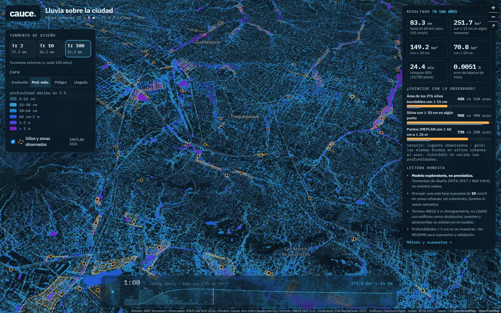

# cauce. · sim-hidro — lluvia sobre la ciudad (5 m)

Viewer for the **sim-hidro** simulation: a dynamic 2D pluvial flood model (rain-on-grid shallow water, local-inertial)
of the Guadalajara Metropolitan Area at **5 m resolution — 8200 × 9000 = 73.8 million cells**, computed on W10's
Radeon RX 580 with WebGPU (≈ 24 min of GPU per 3-hour storm). **Exploratory model, not a forecast.**
Data products, full method, assumptions and validation tables:
[`/labs/shared/hazard/modeled/sim-hidro/README.md`](/labs/shared/hazard/modeled/sim-hidro/README.md).

## Concept
An instrument-panel view of three design storms (Tr 2, 10, 100 years; 60 min of rain, 3 h simulated):
- **Evolución** — depth through time: 5-min slices cross-faded, with the storm hyetograph (bars, mm/h) and the
  flooded-area curve (km² with ≥ 15 cm) in the timeline. Play/pause or scrub; ≥ 10 cm shown.
- **Prof. máx.** — maximum depth during the 3 h at native 5 m (XYZ tiles z10–15, nearest-neighbour).
- **Peligro** — hazard classes from max depth and max depth×velocity (ARR 2019 Book 6 ch. 7 thresholds, simplified).
- **Llegada** — minutes until a cell first holds ≥ 15 cm.
- **Observado** (dashed orange, click for details) — IMEPLAN MUI 2026 sites, zones and points, kept visually distinct
  from the model (blues/violets).
- Right panel: rain, flooded areas, GPU time, mass-balance error, and the comparison with IMEPLAN.

| | Tr 2 | Tr 10 | Tr 100 |
|---|---:|---:|---:|
| rain in 60 min | 37.3 mm | 56.2 mm | 83.3 mm |
| area with max depth ≥ 15 / 30 / 60 cm (km²) | 82 / 36 / 12 | 160 / 83 / 35 | 252 / 149 / 71 |
| share of IMEPLAN *sitios inundables* area ≥ 15 cm (random baseline) | 18 % (6 %) | 33 % (11 %) | 48 % (16 %) |
| IMEPLAN points with ≥ 60 cm within 25 m (random baseline) | 37 % (11 %) | 54 % (19 %) | 73 % (28 %) |
| mass-balance error | 3.6e-5 | 4.9e-5 | 5.1e-5 |

The 15 cm "hit rate" asked for in the brief is ~97–99 % at observed sites but also 94–97 % for the same shapes at
random urban spots (5 m rain-on-grid wets some low point in almost any street-sized polygon); the area share and the
60 cm threshold are what separate observed from random (~3×). Reported vs modelled depth: Spearman ρ ≈ 0.27 (weak).

Also here: `timelapse-tr100.mp4` (6 s, the 36 Tr 100 time slices over the whole domain, rendered with ffmpeg on W10).

## Data used
- Model outputs: `/labs/shared/hazard/modeled/sim-hidro/{stats.json,T2,T10,T100}` (this agent).
- Observed: `/labs/shared/hazard/observed-imeplan-2026.geojson` (IMEPLAN MUI 2026).
- Basemap: OpenFreeMap vector tiles (© OpenStreetMap contributors), AWS Terrarium hillshade.
- Inside the model: INEGI MDT 5 m + Overture buildings (terrain agent), ESA WorldCover 2021, IMTA (2017) design storm.

## Demo mode
`?demo=1` hides the controls and plays a 26 s scripted sequence: Tr 10 storm animated over the whole domain while the
camera tilts into the city (0–15 s) → Tr 100 maximum depth with the IMEPLAN sites (15–20 s) → hazard close-up over
Arroyo de Enmedio / Col. Jauja, Tlaquepaque–Tonalá, the densest overlap of observed sites and modelled > 60 cm
(20–26 s) → caveat card ("modelo exploratorio · no es un pronóstico").
For deterministic capture: `window.__cauceDemo = {duration_s: 26, ready, seek(t)}`; `seek(t)` sets camera, layers and
time slice for second `t`, waits for tiles/images and resolves after two animation frames (~1 s per 1080p frame on W10).
`?demo=1&still` disables autoplay. Other URL options: `?tr=2|10|100`, `?capa=anim|depth|hazard|arrival`,
`?t=<simulated minutes>`, plus a `#zoom/lat/lon/bearing/pitch` hash. A capture script for MP4 is at
`/srv/contorno/data/guadalajara-flood-lab/work/sim-hidro/src/capture.mjs` (W10 copy in `…\labs\sim-hidro\`).

## Limitations (also on screen)
Design storms (not a real event), one assumed drainage rate (10 mm/h on urban cells), no pipes/collectors/tunnels or
operated vasos, bare-earth photogrammetric DTM without bridges or culverts, buildings as solid blocks, infiltration from
land cover only, local-inertial physics (Froude capped), depth-capped wave term above 4 m. Max-depth maps are the
maximum over 3 h at every cell, not one moment. See the data README.
